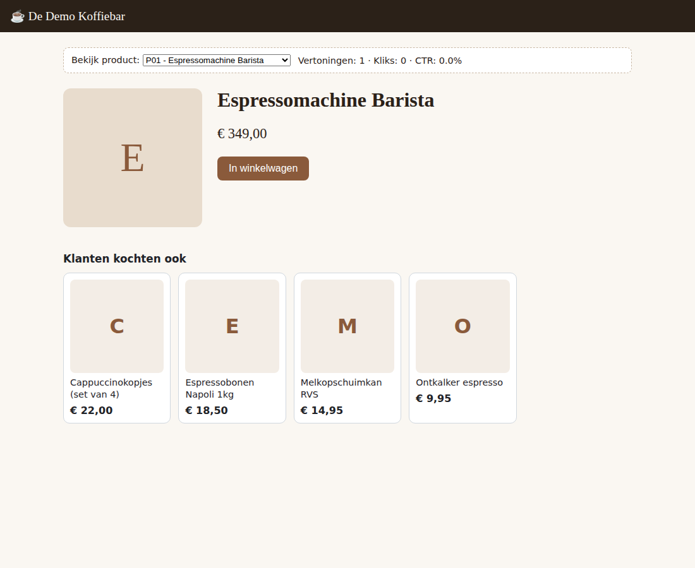

# "Klanten kochten ook"-widget (prototype)

Een insluitbare aanbevelingswidget voor kleine webshops. Hij leert uit de
bestelhistoriek welke producten vaak samen gekocht worden en toont die op de
productpagina of in de winkelwagen.



## Snel starten

Alleen Python 3.9+ nodig, geen externe packages.

```bash
cd widget
python generate_sample.py   # maakt voorbeelddata van een fictieve koffieshop
python server.py            # start op http://localhost:8000/demo/
```

Tests draaien:

```bash
python -m unittest discover -s tests -v
```

## Inbouwen in een webshop

De winkeleigenaar plakt twee regels in zijn productpagina-template:

```html
<div data-recs-product="{{ product.id }}" data-recs-title="Klanten kochten ook" data-recs-k="4"></div>
<script src="https://JOUW-SERVER/widget.js" defer></script>
```

- Voor een winkelwagen: geef meerdere ID's mee, `data-recs-product="P01,P02"`.
- De widget gebruikt Shadow DOM, dus de CSS van de shop wordt niet beïnvloed.
- Als de server onbereikbaar is, toont de widget niets in plaats van een fout.

## Eigen data gebruiken

```bash
python server.py --orders bestellingen.csv --products producten.csv
```

| Bestand | Kolommen |
|---|---|
| bestellingen | `order_id,product_id` (één rij per product per bestelling) |
| producten | `product_id,name,price,url,image` |

Dit is de export die je uit Shopify, WooCommerce of Lightspeed haalt.

## Hoe het werkt

Twee producten lijken op elkaar als ze vaak in dezelfde bestelling zitten:

    sim(a, b) = aantal_samen(a, b) / sqrt(aantal(a) * aantal(b))

Door die cosinusnormalisatie duwen bestsellers niet elk lijstje vol. Paren die
minder dan `--min-co-count` keer (standaard 2) samen gekocht zijn, tellen niet
mee. Is er te weinig data, dan vult de widget aan met de bestsellers.

## API

| Endpoint | Doel |
|---|---|
| `GET /api/recommendations?product=P01&k=4` | aanbevelingen (meerdere `product`-parameters mogen) |
| `GET /api/products` | productcatalogus |
| `POST /api/track` | `{"event": "impression" \| "click"}` vanuit de widget |
| `GET /api/stats` | vertoningen, kliks, CTR: je verkoopargument |
| `GET /widget.js` | het insluitbare script |

## Wat nog nodig is voor een betaald product

Dit is een prototype. Voor echte klanten ontbreekt nog:

1. **Meerdere shops**: een API-sleutel per shop en aparte data per klant.
2. **Automatische sync**: bestellingen ophalen via de Shopify- of WooCommerce-API in plaats van CSV.
3. **Persistente statistieken**: kliks gaan nu verloren bij herstart. Zet ze in SQLite of Postgres.
4. **Omzetmeting**: koppel kliks aan aankopen voor een "+X% orderwaarde"-rapport.
5. **Hosting**: een kleine VPS of Fly.io kost een paar euro per maand en is genoeg voor tientallen shops.
6. **Betalen**: abonnement via Stripe of Lemon Squeezy, of via de Shopify App Store-billing.
